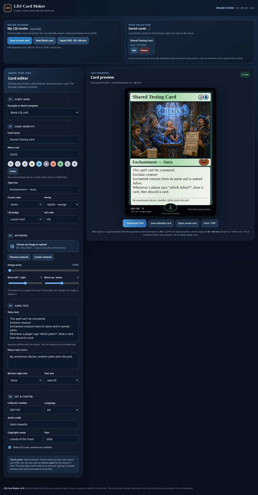
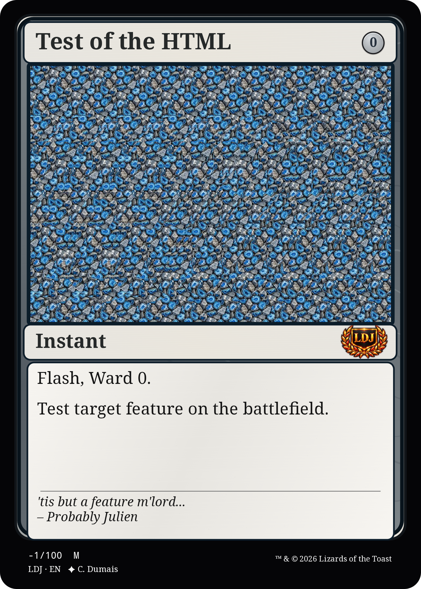

# Features

[Go to LDG's main README](../README.md)

---

## Card Maker

### Versions
- [Card Maker V1][card-maker-v1-launch]
  - [Code for V1][card-maker-v1-html]

<!-- - [Card Maker V1.5][card-maker-v1-5] -->
<!-- - [Card Maker V2][card-maker-v2] -->

[card-maker-v1-launch]: https://saydromey.github.io/LDJ/Features/LDJ_Cards_Maker_V1/LDJ_Card_Maker.html  
[card-maker-v1-html]: LDJ_Cards_Maker_V1/LDJ_Card_Maker.html

## Design Tools

### [Color Frame Prototype][color-frame-prototype-launch]
- [Code for the color frame test prototype][color-frame-prototype-html]

### [Color Frame Prototype V2 - Dual Color Frames][color-frame-prototype-v2-launch]
- [Code for the color frame test prototype][color-frame-prototype-v2-html]

[color-frame-prototype-launch]: https://saydromey.github.io/LDJ/Features/_prototypes/LDJ_Frame_Color_Preview.html  
[color-frame-prototype-html]: _prototypes/LDJ_Frame_Color_Preview.html

[color-frame-prototype-v2-launch]: https://saydromey.github.io/LDJ/Features/_prototypes/LDJ_Frame_Color_Preview_v2-hybrid.html  
[color-frame-prototype-v2-html]: _prototypes/LDJ_Frame_Color_Preview_v2-hybrid.html

---

  <H2>Website Preview</H2>
  
  <H3>Example card made with this feature</H3>
  

  

<!-- 
![Website Preview][img-website-preview]
[img-website-preview]: assets/LDJ_Website_Preview.png "Example Website Preview"
-->

---

## Examples
- https://mtg.cards/
- https://www.kapwing.com/studio/editor
- https://mtgcardbuilder.com/
